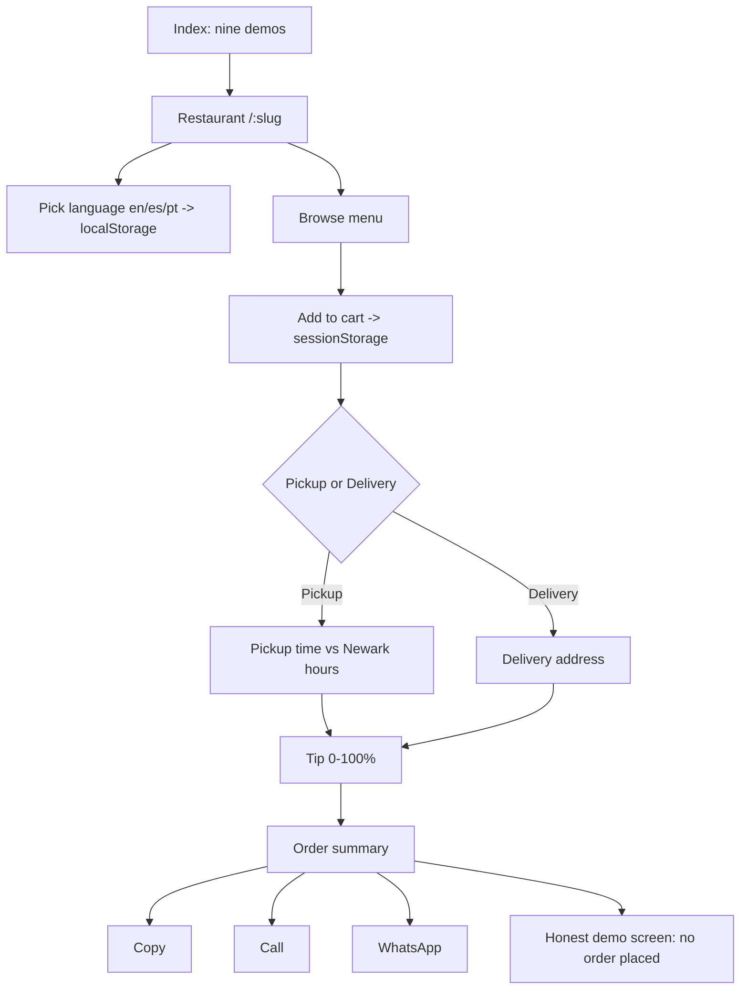

# Restaurant demo sites — App Flow

## Pages
- **Index** (`/`) — lists the nine restaurant demos.
- **Restaurant page** (`/[slug]`) — hero, about, menu, hours (live open/closed on the Newark clock), optional rating, and the order panel. Nine slugs: jv-grill, boi-na-brasa, brisas-del-mar, cantinho-mineiro, cityrub, peruvian-brazas, sabor-unido, virgen-de-la-nube, andros-diner.
- **Sitemap** (`sitemap.xml`) and OG images under `public/og/`.

## Main journey (diner, in-demo)
1. Open a restaurant page in the chosen/remembered language (en/es/pt).
2. Add dishes (stepper, max 99; live-region announces each add and the total).
3. Choose pickup or delivery; enter a pickup time (validated against hours on the Newark clock) or a delivery address.
4. Add a percentage or custom tip (clamped 0–100).
5. Get an order summary to **copy**, **call**, or send on **WhatsApp**. Checkout stops on the honest demo screen — no order is placed.

## Errors / empty states
- Empty cart state; blank delivery address → focus + alert; pickup time past/closed/missing → rejected with a localized message; unpriced dishes → "Priced items, before tax"; closed restaurant/delivery messaging distinct.

## Navigation map (mermaid)

## Open questions
- Confirm the live Pages URLs for each of the nine demos.

## Changelog

- **2026-10-18** — Initial reverse-documented draft from the codebase (executor documentation bot). Facts drawn from the repo/box source at the commit recorded in `/workspace/project-docs/state.json`.
