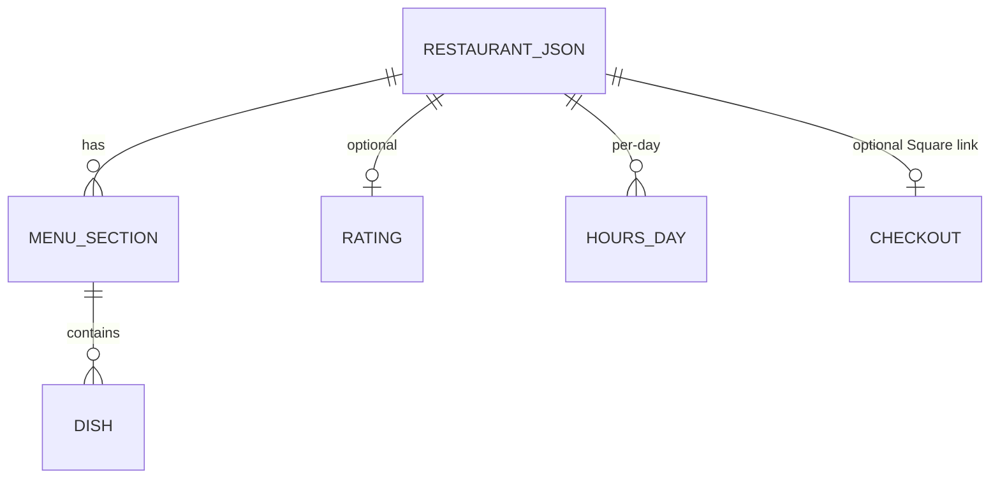

# Restaurant demo sites — Backend Schema

## Datastore
None. Fully static. "Data" is one JSON file per restaurant in `data/restaurants/` (plus `_example.json`), validated at build.

## Restaurant data shape (per `data/restaurants/*.json`)
- `order`, `slug`, `name`, `shortName`, `cuisineLabel {en,es,pt}`, `servesCuisine`, `defaultLang`, `languages[]`.
- `phone`, `phoneDisplay`, `address {street,city,region,postalCode,country}`, `geo {lat,lon}`, `osmUrl`.
- `rating {value, count, source, url}` (optional; validated: https url, 0–5, whole count, checked date).
- `hours` (per-day ranges, Newark clock; nullable), `hero {variant, dek{…}, …}`, palette/type tokens, and a menu (sections → dishes with prices; prices may be unpriced).
- Optional `checkout.squarePaymentLink` (public Square URL; only Square hosts allowed).

## Browser storage keys
- `sessionStorage` — the cart (quantities/fulfillment), rebuilt and allowlisted from the page menu on restore.
- `localStorage` — language choice (`en`/`es`/`pt` only).

## "ER" diagram (build inputs, mermaid)

## Ordering adapters (stubs)
- `src/ordering/{demo,square,stripe,doordash-drive,uber-direct}.mjs`. `demo` returns the honest no-order result; `square` validates and returns a redirect to a Square-hosted link (does not charge); others are stubs. Selected by data, tested by `scripts/test-adapters.mjs`.

## Endpoints / jobs / retention
- No server, endpoints, webhooks, or jobs. Nothing persisted beyond the diner's own browser session. `sitemap.xml` + `robots.txt` generated from the site base.

## Open questions
- If a real ordering path is enabled, confirm which adapter and the merchant account.

## Changelog

- **2026-10-18** — Initial reverse-documented draft from the codebase (executor documentation bot). Facts drawn from the repo/box source at the commit recorded in `/workspace/project-docs/state.json`.
